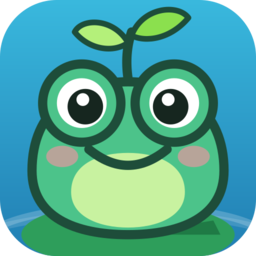
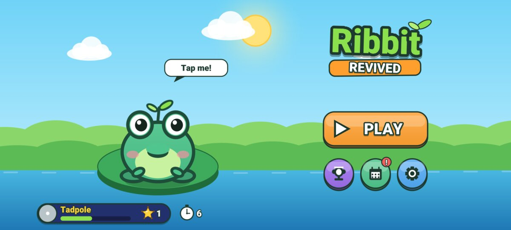
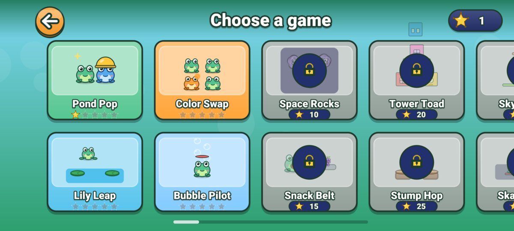
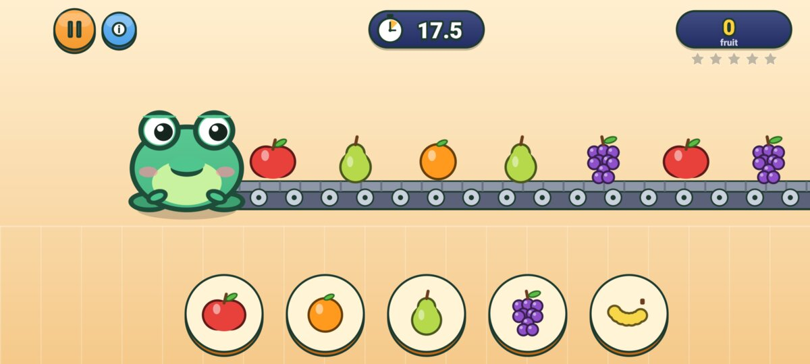
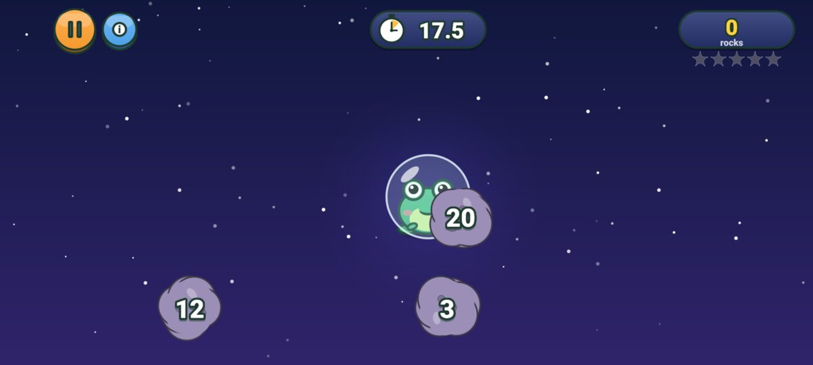
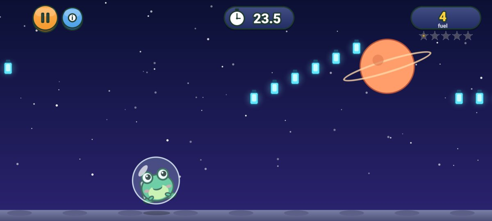
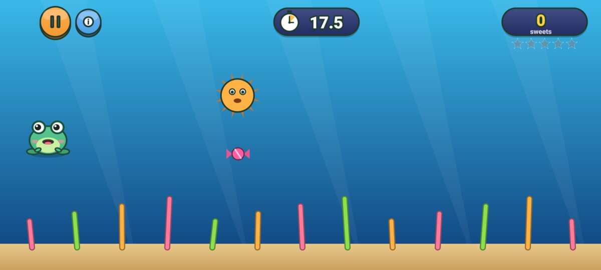
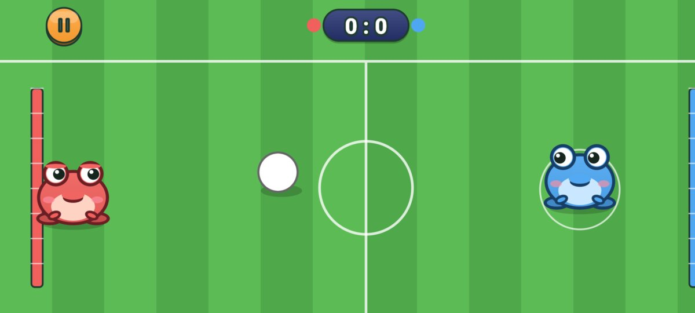
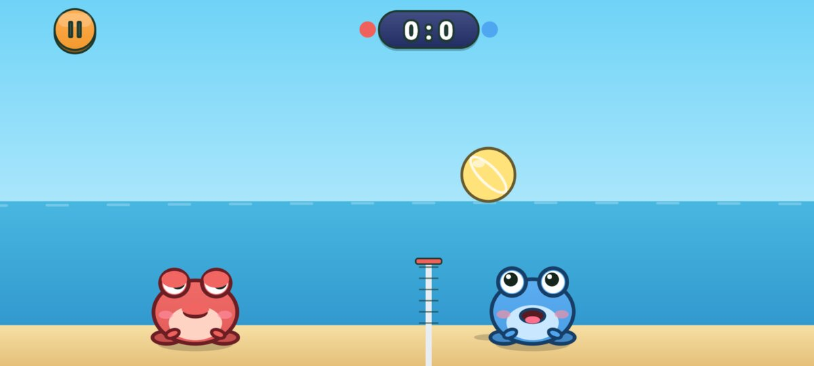

<p align="center">
  
</p>

<h1 align="center">Ribbit Revived</h1>

<p align="center">
  28 quick frog minigames for Android, a fan remake of the classic <b>Tap the Frog</b>.<br>
  No ads, no purchases, no tracking.
</p>

<p align="center">
  <a href="https://github.com/riyadmondol2006/Ribbit-Revived/actions/workflows/build.yml"></a>
  <a href="https://github.com/riyadmondol2006/Ribbit-Revived/releases/latest"></a>
</p>

<p align="center">
  
  
</p>
<p align="center">
  
  
  
  
  
  
</p>

## Download

Get the APK from the [latest release](https://github.com/riyadmondol2006/Ribbit-Revived/releases/latest) and install it. It needs Android 8.0 or newer.

The game checks GitHub for new versions. When there is one, an **Update** button appears on the main menu and opens the download. You can turn this off in Options.

## The original game

Ribbit Revived is based on **Tap the Frog** by Playmous, a collection of 20-second minigames starring a frog, released around 2011. Players popped the frog, fed it, painted it and launched it into space. There were stars to collect, games to unlock, ranks to climb and duels for two players on one phone. It later came in HD, Doodle and Faster editions.

Tap the Frog is no longer on Google Play or the App Store. The last Android version (1.9.2) targets Android 9 and has several problems on current phones:
- it is letterboxed on tall screens;
- its native code is not 16 KB page aligned;
- it carries about ten ad and analytics SDKs whose servers are gone;
- it uses a billing API that Google Play has removed.

This remake keeps the way the original plays. The rules were worked out by reverse engineering the original game:
- the same 28 games;
- the same round lengths, star targets and unlock costs;
- the same rank curve and achievements.

Everything else is new:
- the code;
- the art, all drawn with shapes at runtime;
- the sound effects and music, synthesised in code;
- the names.

No code, art, sound or data from the original is included. The reverse-engineering notes are not in this repository, because they contain decompiled code from the original.

Ribbit Revived is an unofficial fan project. It is not affiliated with or endorsed by Playmous. "Tap the Frog" is used here only to say where the idea came from, and the original game belongs to its owners.

## The games

| # | Tap the Frog | Ribbit Revived | Players |
|---|---|---|---|
| 1 | Pop the Frog | Pond Pop | 1 |
| 2 | Launch the Frog | Space Rocks | 1 |
| 3 | Paint the Frog | Color Swap | 1 |
| 4 | Fly the Frog | Bubble Pilot | 1 |
| 5 | Jump the Frog | Lily Leap | 1 |
| 6 | Feed the Frog | Snack Belt | 1 |
| 7 | Build with the Frog | Tower Toad | 1 |
| 8 | Treat the Frog | Stump Hop | 1 |
| 9 | Leap the Frog | Sky Spring | 1 |
| 10 | Fight the Frog | Belly Bump | 2 or vs CPU |
| 11 | Drive the Frog | Skate Rush | 1 |
| 12 | Double Tap the Frog | Twin Pop | 1 |
| 13 | Spoil the Frog | Pad Catch | 1 |
| 14 | Bounce the Frog | Berry Bounce | 1 |
| 15 | Spacewalk the Frog | Jet Frog | 1 |
| 16 | Pump the Frog | Balloon Duel | 2 or vs CPU |
| 17 | Place the Frog | Ball Swap | 1 |
| 18 | Goal with the Frog | Frog Soccer | 2 or vs CPU |
| 19 | Wrap with the Frog | Gift Wrap | 1 |
| 20 | Pop the Thief Frog | Bandit Pop | 1 |
| 21 | Dive with the Frog | Deep Dive | 1 |
| 22 | Play with the Frog | Frog Volley | 2 or vs CPU |
| 23 | Connect the Frog | Link Up | 1 |
| 24 | Ride the Frog | Wheelie Run | 1 |
| 25 | Sort with the Frog | Shape Sort | 1 |
| 26 | Slide the Frog | Fruit Slide | 1 |
| 27 | Tap the Frog | Quick Draw | 2 or vs CPU |
| 28 | Celebrate with the Frog (bonus) | Cake Duel | 2 or vs CPU |

**How it plays:**
- Single-player rounds last 20 seconds and give up to 5 stars.
- Stars unlock more games and raise your rank.
- Each single-player game has 4 achievements.

## What's new compared with the original

**Fair play:**
- No ads, no in-app purchases and no trackers.
- Bonus clocks (+5 seconds when time runs out) are earned by playing: +1 for each new star, +3 for each new rank, and a daily visit bonus.
- The +5 seconds offer has a "No thanks" button that works.

**Modes:**
- **Practice:** play any single-player game with no timer and no stars. Made for small children.
- **VS CPU:** play all six two-player duels against the computer.
- **Daily challenge:** one game a day with a target score. Beating it pays +3 clocks.

**Accessibility:**
- **Colour marks:** an option that adds a shape for each colour on the frogs and balls, for colour-blind players.
- **Twin Pop:** works with one finger (tap a frog, then tap its twin) as well as with two.

**Modern Android:**
- Targets Android 17 and draws edge to edge around camera cutouts.
- Supports predictive back.
- Native code is 16 KB page aligned.
- Fills wide screens without letterboxing.

Many of these changes answer common complaints in reviews of the original.

## Privacy

The app asks for one permission: internet. It is used only by the update check, which sends one anonymous request to `api.github.com`, at most every six hours. Turning off Options > Updates stops it.

The game does not collect, send or store any personal data. Progress is saved on the phone and included in Android backup.

## Build from source

You need:
- Rust with the Android targets, and `cargo-ndk`;
- Android SDK 37 and NDK 30.0.16248370;
- JDK 21.

```bash
rustup target add aarch64-linux-android armv7-linux-androideabi x86_64-linux-android
cargo install cargo-ndk

./build.sh              # debug APK
./build.sh install      # debug APK, then install and launch on the connected phone
./build.sh release      # release APK
```

Gradle builds the Rust engine itself, through the task `:app:cargoBuild`.

**Signing.** Release builds are signed with the key given in these environment variables. Without them, release builds use the debug key.
- `SIGNING_STORE_FILE`
- `SIGNING_STORE_PASSWORD`
- `SIGNING_KEY_ALIAS`
- `SIGNING_KEY_PASSWORD`

**Jumping into a game.** Debug builds can open a game directly. The mode is optional and can be `practice`, `cpu` or `daily`:

```bash
adb shell am start -n com.riyadm.ribbit.revived/.MainActivity --es level hop
adb shell am start -n com.riyadm.ribbit.revived/.MainActivity --es level sumo:cpu
```

## Automatic builds and releases

GitHub Actions (`.github/workflows/build.yml`) builds a release APK on every push and pull request. The APK is attached to each run as an artifact.

To ship an update:
1. Raise `versionCode` and `versionName` in `app/build.gradle.kts`.
2. Push to `main`.

The workflow then publishes the signed APK as release `v<versionName>`, and installed copies of the game show the Update button.

The signing key comes from these repository secrets:
- `KEYSTORE_BASE64`: the keystore file, encoded with `base64 -w0`;
- `KEYSTORE_PASSWORD`;
- `KEY_ALIAS`;
- `KEY_PASSWORD`.

## How it's built

| Layer | Files | What it does |
|---|---|---|
| Kotlin shell | `MainActivity.kt`, `GameView.kt` | Full-screen activity, cutout insets, OpenGL ES 3 surface with 4x MSAA, multi-touch, haptics, predictive back |
| | `AudioEngine.kt` | Low-latency `AudioTrack` thread that pulls sound from Rust |
| | `FontAtlas.kt` | Draws the system font once; Rust turns it into a distance field |
| | `UpdateChecker.kt` | Looks for a newer GitHub release |
| Rust engine | `render.rs`, `sdf.rs` | One batched SDF shader: smooth rounded boxes, ellipses, pies, glows and outlined text |
| | `audio.rs` | Every sound effect and both music tracks, synthesised in code |
| | `art.rs`, `toys.rs` | The frog, the scenery, the food and the toys, drawn with shapes |
| | `game.rs` | Menus, level select, play flow, results, achievements, options |
| | `levels/*.rs` | The 28 minigames |
| | `profile.rs` | The save file |

Package `com.riyadm.ribbit.revived`. Android 8.0 (API 26) to Android 17 (API 37). Built for arm64-v8a, armeabi-v7a and x86_64.
